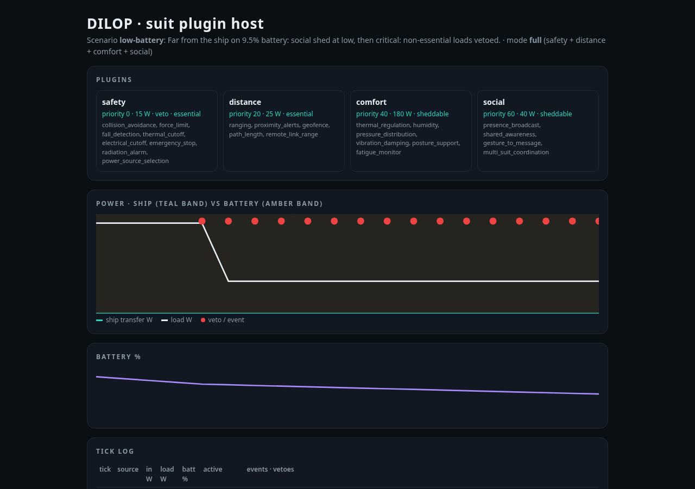

# Dilop: suit plugin host

**Repo:** https://github.com/fitzyracing1/dilop-suit-plugins



Dilop is a plugin host for a suit (exosuit, humanoid, or wearable). The suit computer scans for plugins,
lets you pick a mode, and splits power, compute and bandwidth between them. Plugins talk over a shared bus.
The **safety** plugin is always loaded and can veto any command. This repo is the software side, written
in plain Python with no dependencies. A deterministic simulator stands in for the hardware.

| plugin | priority | does |
|---|---|---|
| **safety** | 0 (veto) | collision avoidance (time-to-contact and clearance), force limit, fall detection, thermal cutoffs, emergency stop, radiation alarm, **power-source selection** |
| **distance** | 20 | ranging and proximity alerts, geofence, path length, remote-link range management |
| **comfort** | 40 | temperature (heat/cool), pressure-bladder redistribution, vibration damping, posture support when fatigued |
| **social** | 60 | presence/status broadcast, peer awareness, peer distress alerts, gesture to message |

### Power logic (from the chat)

> "Safety is in transferring power from nuclear readings to the ship where you are powered or your running on battery
> the nuclear material just uses your presence as a measurement…"

The dosimeter reading only **measures whether a reactor is present**. It never powers anything. When a reactor is
present, the ship's reactor is online, and the link is good and in range, the safety plugin opens a gated, ramped
transfer from the ship. Otherwise the suit runs on battery. At low battery the social plugin is shed. At critical
battery with no ship power, the suit enters a safe baseline and non-essential commands are vetoed. Details are in
[ARCHITECTURE.md](ARCHITECTURE.md) and `dilop/power.py`.

## Run it

Requires Python 3.9 or newer, with no installs needed.

```sh
python -m dilop --list                         # scenarios and modes
python -m dilop -s normal                      # walk near the ship on gated ship power
python -m dilop -s away -n 20                  # walk out of range: ship -> battery
python -m dilop -s low-battery -n 20 --html docs/report.html   # dashboard like the screenshot
python -m dilop -s crash -v                    # a third-party plugin panics and is isolated
python -m dilop -s obstacle --mode work --json # one JSON TickReport per line
python plugin_manager.py                       # the original zip's entry point still works
```

You can also run `pip install .` to get a `dilop-sim` command.

Scenarios: `normal`, `away`, `low-battery`, `obstacle`, `fall`, `reactor-off`, `overheat`, `crash`.
Modes: `work` (safety+comfort+distance), `explore` (safety+distance+social), `social`, `baseline`, `full`.

### Write a plugin

```python
from dilop import Plugin, PluginContract, Resources, Command, SuitState
from dilop.plugin_manager import default_manager

class Lamp(Plugin):
    contract = PluginContract("lamp", ["headlamp"], Resources(power_w=4, compute=0.01), priority=70)
    def step(self, state):
        return [Command("lamp", "display", "headlamp", "on")]

m = default_manager("work")
m.register(Lamp); m.load("lamp")
report = m.tick(SuitState())
print(report.active)   # ['safety', 'distance', 'comfort', 'lamp']
```

## Tests

```sh
python -m unittest discover -s tests -t .
```

There are 25 tests covering the power logic, the manager (modes, safety can't be unloaded, quarantine,
resource arbitration, emergency-stop veto, safe baseline, bus isolation), each plugin, every simulator
scenario, determinism, and the CLI's text/JSON/HTML output. CI runs them on Python 3.9 through 3.13.

## Layout

```
dilop/            package: state, bus, plugin contract, power logic, plugin_manager, simulator, cli, report
dilop/plugins/    safety, distance, comfort, social
plugin_manager.py compatibility shim for the original zip
tests/            unittest suite
ARCHITECTURE.md   tick lifecycle, veto rules, power logic
BOM.yaml          hardware list for a physical build
```

## Origin

Built from the Grok chat "Dilop Computer Plugins for Suits"
(https://grok.com/c/85986bbb-42be-4735-884e-0040f46fcee4). That chat produced a 3.86 KB zip containing a stub
`plugin_manager.py`. This repo turns it into a real package, adds the power logic from the chat's final
message, and adds the simulator and tests.

It is a simulation, not certified safety software. Don't wire it to real actuators without a hardware
e-stop that bypasses it.

## License

MIT

## Plans

This project is free, and its license stays as is. Support it through [GitHub Sponsors](https://github.com/sponsors/fitzyracing1):

- **Free**: use the code, community support.
- **Pro ($49/month)**: priority issues and support.
- **Team ($199/month)**: priority support for your team plus early access.
